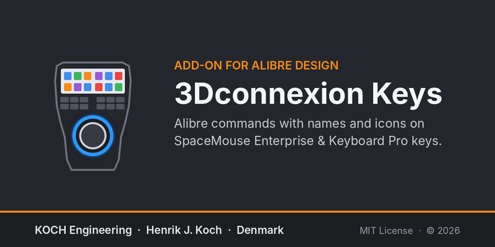
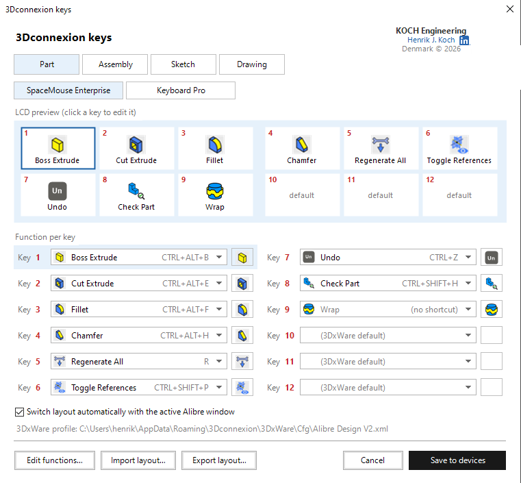
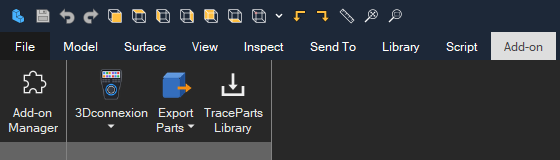

# KOCH 3Dconnexion Keys – SpaceMouse & Keyboard Pro keys for Alibre Design

**Developed by [KOCH Engineering](https://www.linkedin.com/in/henrikjkoch/) (Henrik J. Koch, Denmark). Built with Claude (Anthropic).**

💬 **Questions, ideas or bugs?** Join the discussion in the [Alibre forum](https://www.alibre.com/forum/index.php?threads/three-free-add-ons-for-alibre-design-%E2%80%93-export-parts-send-to-prusaslicer-3dconnexion-keys.27260/) or open a GitHub issue.

With this Alibre Design add-on you choose what the **12 LCD keys of a 3Dconnexion SpaceMouse Enterprise** and the **12 macro keys of a 3Dconnexion Keyboard Pro** do. Each key gets a name and an icon, the way SOLIDWORKS users already have it. Part, Assembly, Sketch and Drawing each get their own layout, and the keys **switch automatically** when you move between them in Alibre.

Alibre Design has no native 3Dconnexion integration for these keys, so the add-on adds one.



## Features

- **12 LCD keys** on the SpaceMouse Enterprise, each with a name and an icon on the display.
- **12 macro keys** on the Keyboard Pro, shown as three groups of four. The keyboard has no display, but the dialog still shows icons, so you can see what is mapped where.
- **Four layouts per device:** Part, Assembly, Sketch and Drawing. The add-on follows the active Alibre window and updates the keys within about half a second.
- **No manual macros.** The add-on creates the 3DxWare macros, button actions (name + icon) and key assignments for you – nothing to set up in the 3Dconnexion app.
- **Every Alibre command in one list.** The add-on reads Alibre's ribbon at runtime, roughly 1,300 commands with their real Alibre icons.
- **Type to search** in every key picker. Functions already used on another key are highlighted.
- **Custom icons:** use Alibre's, generate a coloured initials tile, or pick your own PNG/JPG.
- **Import and export** of layouts as XML files, for backup or for sharing with colleagues.
- Only the devices you own are shown. The add-on reads 3DxWare's device list.
- The 3DxWare profile is **backed up** before every change (the 10 most recent copies are kept).

## Requirements

| | |
|---|---|
| CAD | Alibre Design Professional or Expert, 64-bit (tested with version 29) |
| Hardware | 3Dconnexion **SpaceMouse Enterprise** and/or **Keyboard Pro** (others may work for the keys they share) |
| Driver | **3DxWare 10** with the Alibre Design profile, which 3DxWare installs automatically when Alibre is detected |
| Windows | Windows 10/11, .NET Framework 4.8 |

## Install

1. Download `KOCH-3Dconnexion-Keys-Setup-x.y.z.zip` from **[Releases](../../releases)** and unzip it.
2. Close Alibre Design and run `KOCH-3Dconnexion-Keys-Setup-x.y.z.exe` (Yes / Next / I Agree / Finish).
3. Start Alibre Design and click **Add-on → 3Dconnexion → 3Dconnexion keys…**



The installer is not code-signed, so Windows SmartScreen may say *"Windows protected your PC"*: click **More info → Run anyway**.

**Uninstall** from **Windows Settings → Apps → KOCH 3Dconnexion Keys (Alibre add-on)**. The keys go back to the 3DxWare defaults; your own settings are kept.

### Install from source (developers)

1. Install the [.NET SDK](https://dotnet.microsoft.com/download) (5.0 or newer).
2. Clone this repository, **close Alibre Design**, double-click **`install.cmd`** and answer **Yes**.
   It builds against your newest Alibre installation, installs to `C:\ProgramData\Alibre AddOns\KochSpaceMouse` and registers the add-on (log: `install.log`).
3. Later updates: run `install.cmd` while Alibre is open – only the core is replaced – then click **Add-on → 3Dconnexion → Reload add-on**. `uninstall.cmd` removes a source install.

To build the installer, install [NSIS](https://nsis.sourceforge.io/) and run `makensis installer\setup.nsi` after building both projects in Release.

## Quick start

1. Open a part in Alibre and go to **Add-on → 3Dconnexion → 3Dconnexion keys…**
2. Pick a context tab (**Part**, **Assembly**, **Sketch** or **Drawing**) and a device (**SpaceMouse Enterprise** or **Keyboard Pro**).
3. Click a key in the preview, or a picker below it, type part of a command name (e.g. `fillet`), and press **Enter**.
4. Click **Save to devices**. The add-on creates the macros and key assignments in 3DxWare for you, and the LCD updates within a second or two.

Read the **[User guide](docs/USER-GUIDE.md)** for the details: shortcuts, icons, import/export and troubleshooting.

## Important: how a key runs a command

3DxWare can only send **keystrokes**. A key therefore runs an Alibre command by sending that command's **keyboard shortcut**. Today this means:

- Commands that **have a shortcut in Alibre** (e.g. Extrude Boss = `Ctrl+Alt+B`) work immediately.
- For other commands, assign a shortcut in Alibre (**File → Preferences → Keyboard shortcuts**, or the customise dialog) and enter the **same** shortcut in **Edit functions…**. The dialog warns you on Save if a key has a function without a shortcut.

A future version will run *every* ribbon command directly, with no shortcut needed. See the [roadmap](#roadmap).

## Files on your PC

| What | Where |
|---|---|
| Add-on | `C:\ProgramData\Alibre AddOns\KochSpaceMouse` |
| Your functions, layouts and icons | `%APPDATA%\Koch Engineering\SpaceMouse\` (`settings.xml`, `icons\`) |
| 3DxWare profile that is written | `%APPDATA%\3Dconnexion\3DxWare\Cfg\Alibre Design V2.xml` |
| Profile backups | `%APPDATA%\3Dconnexion\3DxWare\Cfg\bak\*.koch-<timestamp>.bak` |
| Log | `%LOCALAPPDATA%\Alibre AddOns\KochSpaceMouse\addon.log` |

## How it works

```
Alibre Design ──(AlibreX API: active window type)──► KOCH 3Dconnexion Keys add-on
      ▲                                                     │ writes KOCH_* actions, macros and
      │ keyboard shortcut                                   │ button mappings (name + 24×24 PNG)
      │                                                     ▼
3DxWare 10  ◄──────── reloads the profile live ── "Alibre Design V2.xml"
      │
      └─► SpaceMouse Enterprise LCD (HIDButton_13…24) · Keyboard Pro (V3DX_F1…F12)
```

- **Loader / Core:** Alibre locks the add-on DLL while it runs, so `KochSpaceMouse.dll` is only a small loader. It reads `KochSpaceMouse.Core.dll` into memory and can swap it at runtime (**Reload add-on**).
- **Context:** a 500 ms timer asks AlibreX for the top-most session (part, assembly or drawing, and whether a sketch is active). When the context changes, the add-on writes that context's layout to the profile.
- **Profile:** only entries whose IDs start with `KOCH_` are added or removed. Everything else in your 3DxWare profile is left as it is.
- **Command list:** the add-on walks Alibre's DevExpress ribbons through reflection and reads each button's caption, tag, super-tip (for the shortcut) and SVG icon.

## Build from source (developers)

```
Source/
  Loader/   KochSpaceMouse.vbproj   – the add-on DLL Alibre loads (references AlibreX / AlibreAddOn)
  Core/     KochSpaceMouse.Core.vbproj – all logic and UI (.NET Framework 4.8, VB.NET)
```

`install.ps1` finds the newest `C:\Program Files\Alibre Design*` installation, builds both projects with `dotnet build`, and installs them. Alibre's own DLLs are referenced from your installation and are **not** included in this repository.

## Roadmap

- [ ] Run **any** ribbon command without a keyboard shortcut. The add-on will reserve hidden hotkeys and click the ribbon item inside Alibre.
- [ ] Code-signed installer.
- [ ] More 3Dconnexion devices (SpaceMouse Pro, CadMouse Pro).

## Related

- [Export Parts](https://github.com/KOCH-Engineering/alibre-export-parts) exports STL/STEP for every part in an assembly in one click.

## License and trademarks

MIT, © 2026 KOCH Engineering. See [LICENSE](LICENSE).

Alibre and Alibre Design are trademarks of Alibre, LLC. 3Dconnexion, SpaceMouse and 3DxWare are trademarks of 3Dconnexion. LinkedIn and the LinkedIn logo are trademarks of LinkedIn Corporation; the logo is used only as a link to the author's profile. This project is not affiliated with or endorsed by any of these companies. Command icons shown in the dialog are read from your own Alibre installation at runtime and are not distributed with this project.

## Support

This project is free and open source. If it saves you time and you'd like to say thanks, you can [buy me a coffee ☕](https://buymeacoffee.com/henrikkoch) – thank you!
