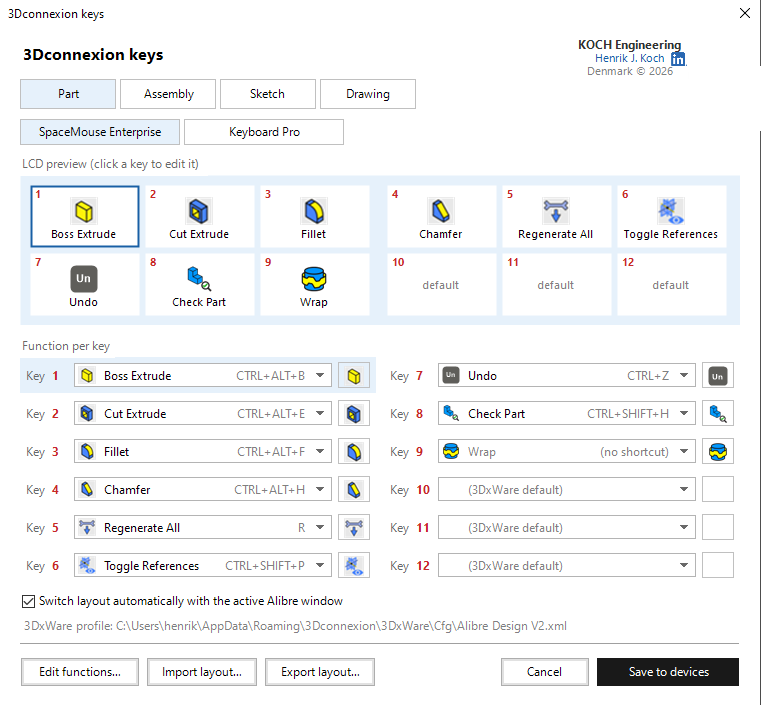

# KOCH SpaceMouse – User guide

*KOCH Engineering · Henrik J. Koch · Denmark*

This guide covers everything in the **SpaceMouse keys** dialog. For installation, see the [README](../README.md#install).

---

## 1. Opening the dialog

In Alibre Design, choose **Add-on → SpaceMouse → SpaceMouse keys…**

The **SpaceMouse** menu has two entries:

| Entry | What it does |
|---|---|
| **SpaceMouse keys…** | Opens the dialog described below |
| **Reload add-on** | Loads a newly installed version without restarting Alibre (used after `install.cmd` while Alibre is open) |

---

## 2. The dialog, top to bottom

### 2.1 Context tabs: Part · Assembly · Sketch · Drawing

Each context has its own layout. The tab you choose decides which layout you are editing.

| Context | Active when… |
|---|---|
| **Part** | a part window is in front and no sketch is being edited |
| **Assembly** | an assembly window is in front |
| **Sketch** | you are editing a sketch in a part |
| **Drawing** | a 2D drawing window is in front |

### 2.2 Device: SpaceMouse Enterprise · Keyboard Pro

The add-on shows a button for each 3Dconnexion device that 3DxWare knows about. If it can't tell, it shows both. **Each device has its own layout for each context**, so you get 4 × 2 = 8 layouts in total.

### 2.3 Key preview

- **SpaceMouse Enterprise:** 2 rows of 6, like the real LCD, with the gap between keys 3/4 and 9/10.
- **Keyboard Pro:** 1 row of 12 in three groups of 4 (keys 1–4, 5–8, 9–12). The keyboard has no display, so the icons are only there to give you an overview.

The red numbers are the key numbers. Keys used in more than one place show the same icon on each.

| Mouse action on a key | Result |
|---|---|
| **Left-click** | Opens the function picker for that key |
| **Right-click** | Choose your own icon for the function on that key |

### 2.4 Function per key

Below the preview is one row per key: keys 1–6 on the left and 7–12 on the right. Each row has:

- **The picker:** click it, or just start typing, and a search box opens.
  - Type any part of the name, e.g. `ext boss` finds *Extrude Boss*. All words must match, and case doesn't matter.
  - Use **↑ ↓ PgUp PgDn** to move and **Enter** to choose. **Esc** cancels.
  - Functions **with a keyboard shortcut** are listed first and show it on the right.
  - An **amber background** with "key *n*" means the function is already on another key in this layout.
  - Choose **(3DxWare default)** to give the key back to 3DxWare's default.
- **The icon button** on the right of the row lets you choose an image for that function.

### 2.5 Switch layout automatically

When this is ticked (the default), the add-on checks the active Alibre window twice a second and loads the matching layout onto the devices. Untick it if you want the keys to stay fixed.

### 2.6 Buttons at the bottom

| Button | What it does |
|---|---|
| **Edit functions…** | Opens the function catalogue: names, shortcuts, categories and icons (section 3) |
| **Import layout…** | Loads a layout XML (yours or a colleague's) into the dialog |
| **Export layout…** | Saves all layouts to an XML file |
| **Cancel** | Closes the dialog without changing anything |
| **Save to SpaceMouse** | Saves your settings and writes the current context to 3DxWare. The LCD updates within a second or two. |

---

## 3. Functions and keyboard shortcuts

### 3.1 Why shortcuts matter

The 3DxWare driver can only send **keystrokes** to Alibre. A key therefore runs a command by "typing" that command's **keyboard shortcut**.

- When you pick an Alibre command that already **has** a shortcut (shown on the right in the list), the key works straight away.
- When a command has **no** shortcut, the key shows its name and icon but does nothing until you add one. **Save** warns you about such keys.

> A coming version will run every ribbon command directly, so no shortcut will be needed.

### 3.2 Giving an Alibre command a shortcut

1. In Alibre, open the keyboard-shortcut customisation (under **Preferences / Customize**, depending on your version) and assign a free combination, e.g. `Ctrl+Alt+Shift+1`.
2. In **SpaceMouse keys… → Edit functions…**, select the function, click the **Keyboard shortcut** box and **press the same keys**.
3. Click **Close**, then **Save to SpaceMouse**.

Tip: combinations with `Ctrl+Alt+Shift` are rarely used by Windows or other programs.

### 3.3 Edit functions…

| Field / button | Meaning |
|---|---|
| **Name** | The text shown on the LCD (keep it short, ~12 characters fit nicely) |
| **Keyboard shortcut in Alibre** | Click the box and press the keys. **Clear** removes it. |
| **Category** | Part / Assembly / Sketch / Drawing / General. This sets the colour of a generated icon. |
| **Icon → Pick icon…** | Use your own PNG/JPG; it is scaled and stored in your settings folder |
| **Icon → Use generated** | A coloured tile with the function's initials |
| **Add / Delete** | Create your own function (e.g. for a macro or Alibre Script shortcut) or remove one. Keys that used a deleted function go back to the 3DxWare default. |
| **Import from Alibre…** | Lists Alibre's ribbon commands with icons, so you can tick several at once. "Only commands with a keyboard shortcut" filters the list. |

---

## 4. Icons

Each key on the SpaceMouse LCD shows a 24 × 24 icon with the function name below it. Icons come from, in order:

1. **Your own image**, if you picked one (right-click the key, the row's icon button, or **Edit functions… → Pick icon…**)
2. **Alibre's own ribbon icon**, copied from your Alibre installation when you choose the command
3. A **generated tile**: the function's initials on a colour that matches its category

Images are saved in `%APPDATA%\Koch Engineering\SpaceMouse\icons\`. Simple, high-contrast images with transparent backgrounds look best on the small LCD.

---

## 5. Sharing and backing up layouts

- **Export layout…** writes all layouts for both devices and all four contexts, together with the functions they use, to one `.xml` file.
- **Import layout…** reads such a file. Functions are matched by name; ones you don't already have are added to your catalogue. The imported layouts replace your current ones.
- Everything also lives in `%APPDATA%\Koch Engineering\SpaceMouse\settings.xml`. Copy that folder to move your whole setup to another PC.

---

## 6. What the add-on changes in 3DxWare

- It only writes to Alibre's profile, `%APPDATA%\3Dconnexion\3DxWare\Cfg\Alibre Design V2.xml`.
- It only adds or removes entries whose IDs start with **`KOCH_`**. Your other 3DxWare settings (speed, axes, radial menus, other keys) are not touched.
- Before each write, the old profile is copied to `Cfg\bak\Alibre Design V2.koch-<date-time>.bak`. The 10 newest copies are kept.
- **To restore the original:** close the 3DxWare settings window, copy the oldest `.koch-….bak` back as `Alibre Design V2.xml`, or run `uninstall.cmd`.

**Keyboard Pro and the 3DxWare settings app:** keys you mapped *globally* in the 3Dconnexion app (e.g. Esc on key 8) live in a shared profile. A key you set in KOCH SpaceMouse belongs to the Alibre profile, so it applies **only while Alibre is active**. Leave a key on *(3DxWare default)* to keep your global mapping for it.

---

## 7. Troubleshooting

| Symptom | What to try |
|---|---|
| The LCD shows the 3DxWare defaults or "Desktop" | Click in the Alibre window so it has focus. Check that 3DxWare shows the *Alibre Design* profile. If 3DxWare got stuck, restart the 3DxWare service or the PC. |
| A key shows the right name but does nothing | The function has no shortcut, or the shortcut differs from Alibre's. See section 3.2. |
| The keys don't follow Part/Assembly/Sketch | Make sure **Switch layout automatically** is ticked and click **Save to SpaceMouse** once. |
| The command list is short or has no icons | Open a part *and* an assembly window first (the add-on reads the ribbons of open windows), then reopen the dialog. |
| The **SpaceMouse** menu is missing in Alibre | Check that `C:\ProgramData\Alibre AddOns\KochSpaceMouse` exists, then run `install.cmd` again with Alibre closed. Look in **Add-on Manager** that *KOCH SpaceMouse* is enabled. |
| Anything else | Look at `%LOCALAPPDATA%\Alibre AddOns\KochSpaceMouse\addon.log` and attach it to a [GitHub issue](../../issues). |

---

## 8. Uninstalling

Close Alibre and double-click **`uninstall.cmd`**. It:

- unregisters and deletes the add-on,
- removes all `KOCH_` entries from the 3DxWare profiles (a `.before-uninstall.bak` copy is made),
- **keeps** your settings in `%APPDATA%\Koch Engineering\SpaceMouse`. Delete that folder by hand if you don't need it.

---

*KOCH SpaceMouse is developed by KOCH Engineering (Henrik J. Koch, Denmark) with a lot of help from Claude (Anthropic). Feedback and ideas are welcome on [LinkedIn](https://www.linkedin.com/in/henrikjkoch/) or as GitHub issues.*
